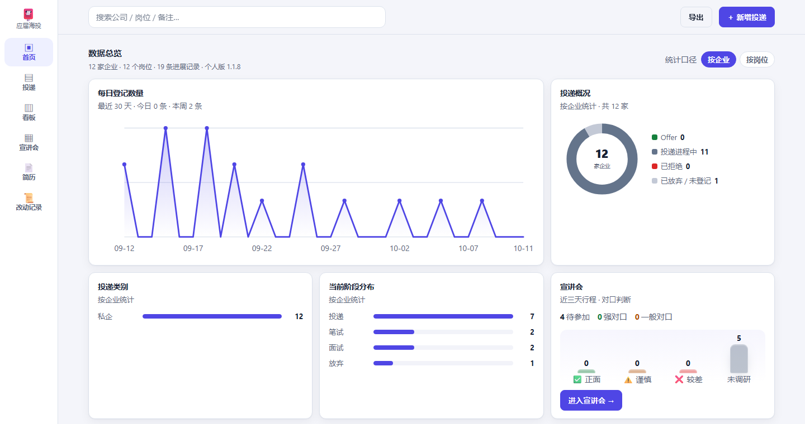
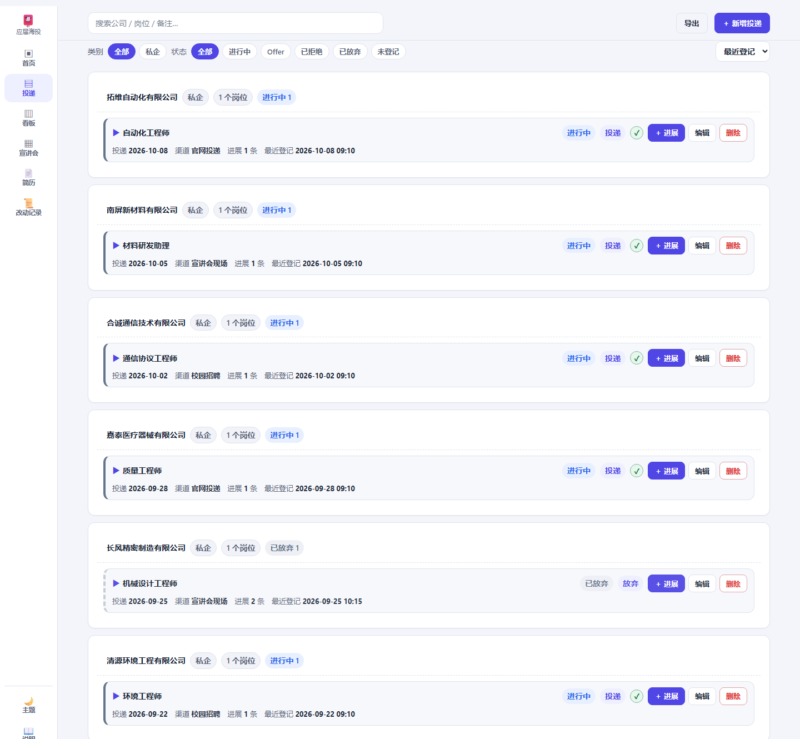

# 应届海投管理（offer-tracker）

一个**纯本地**的求职进度管理小工具：记录投递到哪一步、看宣讲会行程、随手记备忘，
外加一个**简历编辑器**（导出 PDF / PPTX）。

Windows 桌面程序，数据是一个 SQLite 文件，**不联网也能用**（只有「同步宣讲会」和「检查更新」会联网）。

## 界面





> 界面演示：**所有记录均为合成示例数据**（公司、岗位、日期都是编的，不对应任何真实投递）。

<!--
TODO(2F) 首发前还要补的：
  · `licenses/` 与第三方许可清单 —— 便携包里已随包生成（`licenses/THIRD-PARTY.md`）
-->

---

## 它能做什么

| 模块 | 说明 |
| --- | --- |
| **投递管理** | 投递记录、进展阶段、统计总览；状态与阶段的推进都有审计记录 |
| **宣讲会** | 从学校就业网抓取宣讲会行程，可标记「已投递」并自动生成投递记录（**目前适配广东工业大学 GDUT 就业网**，见下） |
| **简历编辑** | 基本信息 / 教育 / 项目 / 技能 / 获奖 + 自定义板块；打印成 PDF、导出 PPTX、支持证件照 |
| **备忘 / 调研** | 随手记；把岗位调研文本粘回来，按公司名归档 |
| **数据安全** | **每次启动自动备份一份**（`data/backups/<时间戳>/`，不覆盖、不自动清理）；所有写操作进审计日志 |

## 怎么运行

### 方式一：便携版（推荐，机器上不需要装 Python）

1. 到 [Releases](../../releases) 下载最新的便携包（zip）。
2. **解压到一个普通的本地文件夹**（桌面、下载、文档都行）。
3. 双击解压出来的**便携启动脚本**（和 `runtime\`、`app\` 并排的那个 `.cmd`）。

> ⚠️ **别解压到被安全软件 / 企业策略"打标"的位置**：这类位置会被 .NET 当成"网络位置"，
> 表现为程序起不来（日志里会出现 `Failed to resolve Python.Runtime.Loader.Initialize`）。
> 换到桌面 / 文档再试即可。

### 方式二：源码运行（要自己装 Python）

需要 **Windows 10/11 x64** + **Python 3.12** + **WebView2 运行时**（Win11 自带；Win10 一般随 Edge 装好了）。

```bat
pip install pywebview
:: 可选：要用「导入 Excel」才需要
pip install openpyxl
```

然后双击 `app\启动（调试窗口）.cmd`（保留命令行输出，方便看报错）。
**没有构建步骤**：前端就是 `app\web\index.html` 一个文件，改完刷新页面就生效。

### 方式三：双击 `app\启动（安全模式）.cmd`

**窗口长得不对劲**（没有边框、拖不动、一片黑、白屏）时用它 —— 它会忽略配置、用最保守的方式打开，
一定能进，数据不受影响。

## 你的数据在哪

| 你怎么装的 | 数据 / 日志位置 |
| --- | --- |
| 便携版（解压即用） | 程序目录下的 `app\data\`、`app\logs\` |
| 首次安装的桌面版 | `%LOCALAPPDATA%\ResumeTracker\data\`、`\logs\` |
| 从旧版升级上来的 | **保持原样**（升级不会搬动你的数据） |

- **备份就是复制 `data\` 这个文件夹**。程序每次启动也会自己备份一份到 `data\backups\`。
- `data\` 里的东西**不要手改**，程序自己在管。
- `change_log.jsonl` 是审计记录（含删除前的完整数据），**不建议删**。

## 关于自动更新

程序会**每天最多一次**在后台检查 GitHub Releases 上有没有新版本：

- 检查失败（断网、被墙、限流）**静默跳过**，不影响使用；
- 有新版本时**由你点确认**才会下载安装，**不会静默替换**；
- 更新**只替换程序文件**，**绝不碰** `data\`、`config.json`、个人画像、日志；
- 安装前校验 SHA-256、失败自动回滚；安装需要**先关掉程序**。

> ⚠️ 两点如实说明：① 目前的构建**没有代码签名**，Windows SmartScreen 可能提示"未知发布者"；
> ② SHA-256 只能证明"下载的字节和发布的一致"，**不能证明发布者身份**（那需要签名）。
> 另外：如果你自己改过程序文件，更新会覆盖它们 —— 想改就 fork 一份。

## 关于联网与隐私

| 会联网的功能 | 发出去什么 |
| --- | --- |
| 同步宣讲会 | 向学校就业网发普通网页请求（需要电脑上有 Chrome 或 Edge 做无界面渲染） |
| 检查更新 | 一个普通的 GET 请求，**不带任何用户信息、不带唯一 ID**；连接本身会让 GitHub 看到你的出口 IP 与请求时间 |

除此之外**全部本地运行**：没有账号、没有遥测、没有云端存储。简历与投递数据只在你自己的机器上。

## 关于「宣讲会」模块与学校适配

宣讲会抓取目前**针对广东工业大学（GDUT）就业网**写的（这是作者的学校）。
想适配别的学校，需要照着 `app/core/talks.py` / `app/core/talk_sync.py` 的解析规则加一个适配器，
欢迎开 issue 说明你们学校的页面结构。

## 自检

这个项目自带一套自检（改完代码必须跑，见 `AGENTS.md`）。常用的几个不用开程序：

```bat
python tools\test_architecture.py    :: 依赖方向（core 只许标准库、SQL 只从 store 出…）
python tools\test_core.py            :: 纯逻辑
python tools\test_schema.py          :: 数据库结构与老库升级
python tools\test_store.py           :: 数据库访问层
python tools\test_resume.py          :: 简历域
python tools\test_resume_pptx.py     :: PPTX 导出
python tools\test_resume_photo.py    :: 证件照校验
python tools\test_data_safety.py     :: 数据红线（发布包 / 排除清单 / 隐私自查）
node   tools\test_web_lib.js         :: 前端纯函数
```

需要程序在跑的那几道（界面、外壳、动作、关窗退出）见 `AGENTS.md` 的命令清单。

## 已知限制（写在前面，省得你踩）

- **只支持 Windows x64**；界面**只有中文**。
- 便携包约 **73 MB**（里面装了一份 Python 运行时）；压缩包约 **17 MB**。
- **没有代码签名**（见上）。
- 宣讲会同步**只适配 GDUT**；导出 PDF 走的是浏览器打印链路，需要电脑上有 Edge / Chrome。

## 许可证

本项目自有代码采用 **MIT**（见 `LICENSE`）。
用到的第三方组件（CPython、pywebview、pythonnet 等）各自的许可与版权声明保留在其发行物内；
便携包里随包生成一份 `licenses/`（含 CPython 的 PSF 条款全文与第三方清单）。
